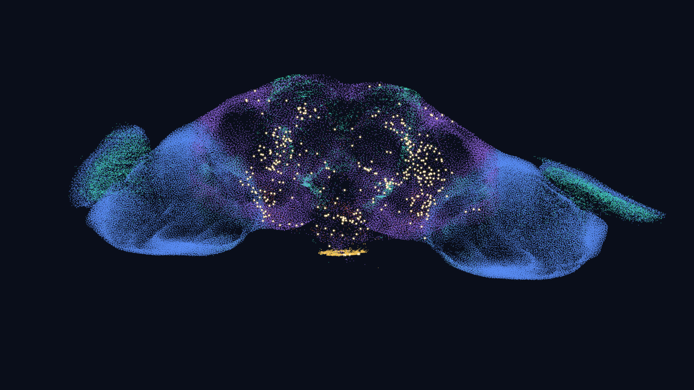
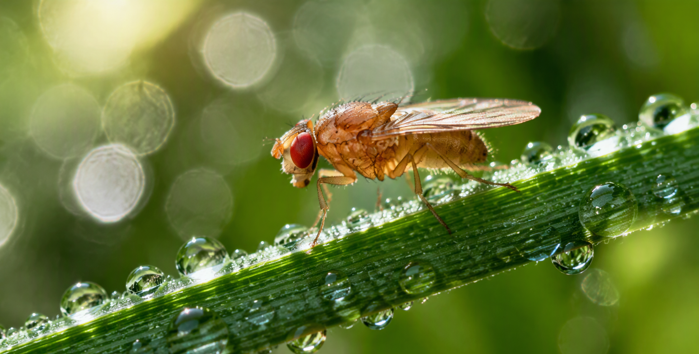
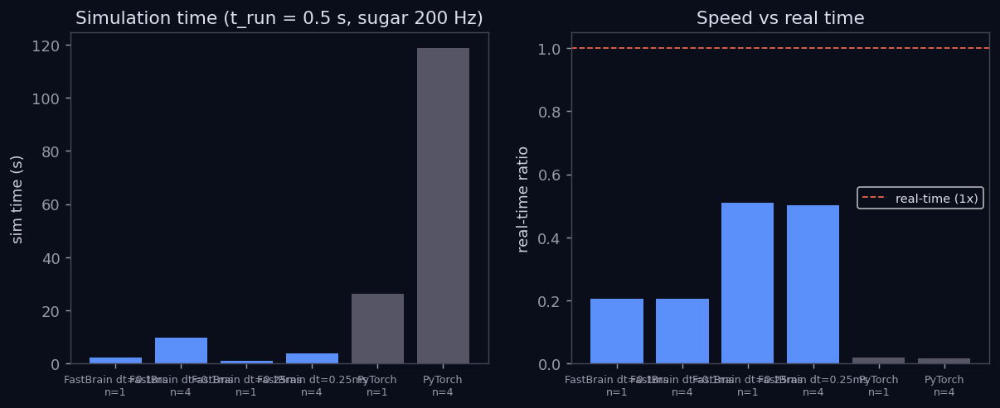
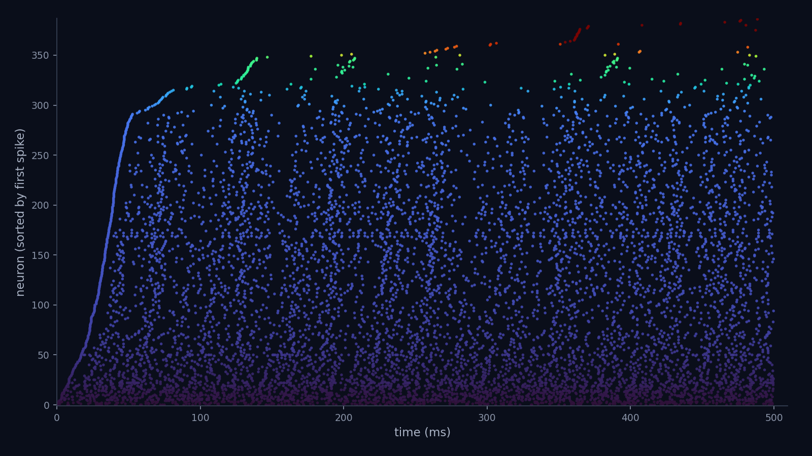
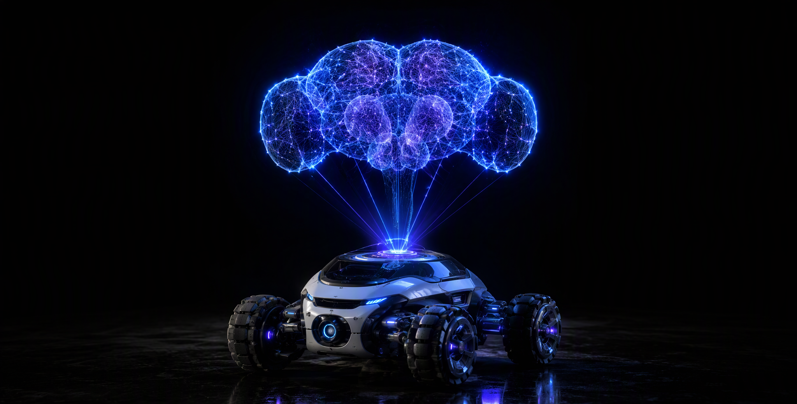
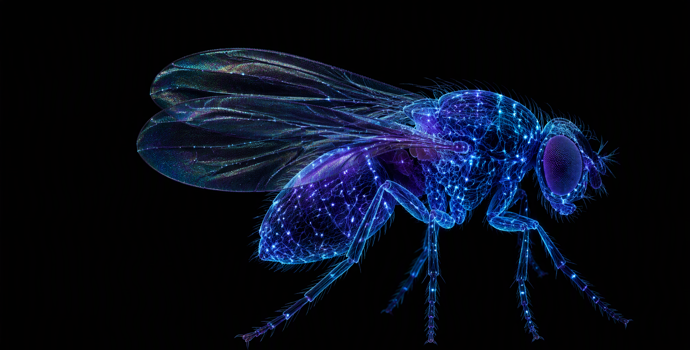

<div align="center">

# FastBrain · 果蝇全脑实时仿真

**Real-time whole-brain *Drosophila* simulation on consumer GPUs**
**在消费级 GPU 上实时运行果蝇全脑模型**

[中文](#zh) · [English](#en) · [完整双语报告 Full report](docs/index.html) · [在线报告 Live report](https://arcadiae.github.io/fly-brain/)



*13.8 万神经元全脑仿真，亮点为糖味觉刺激下游的放电神经元 · 138,639-neuron whole-brain simulation; bright dots are neurons firing downstream of sugar taste stimulation*

</div>

---

<a id="zh"></a>
# 中文版

**目录**：[项目简介](#zh-intro) · [本分支新增](#zh-new) · [核心结果](#zh-results) · [快速开始](#zh-quick) · [项目结构](#zh-structure) · [数据](#zh-data) · [研究路线](#zh-roadmap) · [许可证与致谢](#zh-license)

<a id="zh-intro"></a>
## 项目简介

本仓库是 [eonsystemspbc/fly-brain](https://github.com/eonsystemspbc/fly-brain)（Eon Systems PBC）的研究分支。上游项目实现了 Shiu et al. 2024（[Nature](https://www.nature.com/articles/s41586-024-07763-9)）的果蝇全脑渗漏积分发放（LIF）模型——基于 [FlyWire](https://flywire.ai/) v783 连接组（138,639 个神经元、约 1500 万个突触），可对任意神经元集合做光遗传式激活/沉默并观察脉冲在全脑的传播，并提供 Brian2 / Brian2CUDA / PyTorch / NEST GPU / GeNN / Brian2GeNN 六个后端的统一基准。

<div align="center">


*本项目的主角——黑腹果蝇（<i>Drosophila melanogaster</i>），13.8 万个神经元就够用*
</div>

[返回目录](#zh)

<a id="zh-new"></a>
## 本分支新增

| 组件 | 说明 |
|---|---|
| **FastBrain 引擎** `experiments/fast_brain.py` | 事件驱动突触块压缩 + CUDA Graph 整段回放；每步 CUDA 内核数从约 75 降至约 33；显存约 0.45 GB |
| **第 7 个基准后端** `code/run_fastbrain.py` | 接入官方基准体系（`main.py --fastbrain`），与其他后端同口径计时、同格式脉冲导出 |
| **系统验证** `experiments/validate_matrix.py` | 刺激 × 时长 × 种子 × dt 全矩阵，含种子噪声地板与 10 秒漂移检查 |
| **实时控制台** `experiments/live_server.py` | WebSocket 推帧，点击细胞类型即刺激、示波器探针、暂停/重置（`run_live.bat`） |
| **3D 回放** `experiments/export_3d.py` | 单文件 HTML：坐标 + 脉冲 + 膜电位波形（`run_replay.bat`） |
| **双语报告站** [`docs/index.html`](docs/index.html) | 可跳转目录、基准图表、验证结果、研究路线 |

[返回目录](#zh)

<a id="zh-results"></a>
## 核心结果

糖味觉 GRN 200 Hz 刺激，t_run = 0.5 s，RTX 3060 Laptop（6 GB）：

| 后端 | n_run | 仿真耗时 | 实时比 |
|---|---|---|---|
| PyTorch (CUDA) | 1 | 26.30 s | 0.019× |
| **FastBrain dt 0.25** | 1 | **0.98 s** | **0.51×** |
| FastBrain dt 0.1 | 1 | 2.43 s | 0.21× |

**仿真速度约为 PyTorch 后端的 27–30 倍**，各后端耗时对比如下图：



精度验证（2 刺激 × 2 时长 × 5 种子 × 3 种 dt）：FastBrain 与参考实现的差异在所有指标上均落在参考模型自身的种子噪声之内（放电率相关 0.990 vs 噪声地板 0.991），10 秒长程无漂移。糖刺激实验的全脑脉冲栅格如下图，更多图表见[双语报告](docs/index.html)：



[返回目录](#zh)

<a id="zh-quick"></a>
## 快速开始

```bash
conda env create -f environment.yml && conda activate brain-fly   # 完整后端（Linux/WSL2）
# 本机最小环境（Windows）：Python 3.10 venv + torch(cu126) + brian2，见 experiments/NOTES.md

python main.py --fastbrain --t_run 0.5 --n_run 1          # FastBrain 基准
python experiments/validate_matrix.py --quick             # 引擎验证（冒烟）
python experiments/validate_matrix.py --full              # 引擎验证（完整矩阵）
run_live.bat                                              # 实时交互控制台
run_replay.bat                                            # 生成并打开 3D 回放
```

[返回目录](#zh)

<a id="zh-structure"></a>
## 项目结构

```
fly-brain/
├── main.py                     # 基准入口（CLI）
├── code/
│   ├── benchmark.py            # 调度器：配置、日志、分发
│   ├── run_fastbrain.py        # ★ FastBrain 基准后端（本分支新增）
│   ├── run_pytorch.py          # PyTorch 参考后端（含代理梯度）
│   └── ...                     # Brian2 / Brian2CUDA / NEST GPU / GeNN / Brian2GeNN
├── experiments/
│   ├── fast_brain.py           # ★ FastBrain 引擎
│   ├── validate_matrix.py      # ★ 系统验证矩阵
│   ├── live_server.py          # ★ 实时控制台服务
│   ├── NOTES.md                # 实验日志（全部性能/精度数字）
│   └── RESEARCH.md             # 研究情报与路线图
├── docs/
│   ├── index.html              # ★ 双语报告站
│   └── assets/                 # 数据图表、截图与插画
└── data/                       # FlyWire v783 数据、基准结果、spike parquet
```

[返回目录](#zh)

<a id="zh-data"></a>
## 数据

模型使用 FlyWire 连接组 v783（公开版）。基准输出（`data/results/local_fastbrain/`）为一脉冲一行的 parquet（`time_ms`、`trial`、`neuron_index`、`flywire_id`、`exp_name`）。论文套件数据（`nature_2026_07`，600 个 parquet）存于 Google Drive，校验方式见[上游 README](README_UPSTREAM.md)。

[返回目录](#zh)

<a id="zh-roadmap"></a>
## 研究路线

- **Phase 0 ✅** 引擎系统验证（见上方核心结果）
- **Phase 1 ⏳** 脉冲全脑模型 vs 公开钙成像数据的首次动力学级基准（DANDI [001869](https://dandiarchive.org/dandiset/001869)；Aimon 2019，CRCNS）+ 已发表结论的敏感性/null 审计
- **Phase 2（待定）** 贝叶斯优化刺激逆向设计 或 蘑菇体学习嵌入全脑——终极目标：让这颗脑子开上小车

方法论红线：一切结论内置 degree-matched 重连 null 对照。详细情报见 [`experiments/RESEARCH.md`](experiments/RESEARCH.md)。

<div align="center">


*Phase 2 概念图：全脑模型驱动具身智能体*
</div>

[返回目录](#zh)

<a id="zh-license"></a>
## 许可证与致谢

GPL-2.0-or-later（见 [LICENSE](LICENSE)）。上游 © Eon Systems PBC；Shiu et al. 原始代码（`code/paper-phil-drosophila/`）为 MIT。详细安装说明（NEST GPU 源码编译、Brian2GeNN 独立环境等）见 [README_UPSTREAM.md](README_UPSTREAM.md)。

[返回目录](#zh)

<div align="center">


</div>

---

<div align="center">

</div>

---

<a id="en"></a>
# English Version

**Contents**: [Introduction](#en-intro) · [What's new in this fork](#en-new) · [Key results](#en-results) · [Quickstart](#en-quick) · [Project structure](#en-structure) · [Data](#en-data) · [Research roadmap](#en-roadmap) · [License & credits](#en-license)

<a id="en-intro"></a>
## Introduction

This repository is a research fork of [eonsystemspbc/fly-brain](https://github.com/eonsystemspbc/fly-brain) (Eon Systems PBC). The upstream project implements the whole-brain leaky integrate-and-fire model of the adult fruit fly from Shiu et al. 2024 ([Nature](https://www.nature.com/articles/s41586-024-07763-9)) — built on the [FlyWire](https://flywire.ai/) v783 connectome (138,639 neurons, ~15M synapses) — with optogenetic-style activation/silencing of arbitrary neuron sets and a unified benchmark across six backends (Brian2, Brian2CUDA, PyTorch, NEST GPU, GeNN, Brian2GeNN).

<div align="center">


*The protagonist of this project — <i>Drosophila melanogaster</i>: 138k neurons are all you need*
</div>

[Back to contents](#en)

<a id="en-new"></a>
## What's new in this fork

| Component | Description |
|---|---|
| **FastBrain engine** `experiments/fast_brain.py` | Event-driven synapse-block compression + whole-graph CUDA Graph replay; ~33 CUDA kernels per step instead of ~75; ~0.45 GB VRAM |
| **7th benchmark backend** `code/run_fastbrain.py` | Integrated into the official benchmark (`main.py --fastbrain`), same timing conventions and spike-export schema as other backends |
| **Systematic validation** `experiments/validate_matrix.py` | Full stimulus × duration × seed × dt matrix with a seed-noise floor and a 10 s drift check |
| **Live console** `experiments/live_server.py` | WebSocket streaming, click-to-stimulate by cell type, oscilloscope probes, pause/reset (`run_live.bat`) |
| **3D replay** `experiments/export_3d.py` | Single-file HTML: coordinates + spikes + voltage traces (`run_replay.bat`) |
| **Bilingual report** [`docs/index.html`](docs/index.html) | Clickable TOC, benchmark charts, validation results, research roadmap |

[Back to contents](#en)

<a id="en-results"></a>
## Key results

Sugar GRN 200 Hz stimulation, t_run = 0.5 s, RTX 3060 Laptop (6 GB):

| Backend | n_run | Sim time | Real-time ratio |
|---|---|---|---|
| PyTorch (CUDA) | 1 | 26.30 s | 0.019× |
| **FastBrain dt 0.25** | 1 | **0.98 s** | **0.51×** |
| FastBrain dt 0.1 | 1 | 2.43 s | 0.21× |

**~27–30× faster simulation than the PyTorch backend.** Per-backend comparison below:


Validation (2 stimuli × 2 durations × 5 seeds × 3 dt values): FastBrain is indistinguishable from the reference's own seed noise on every metric (rate correlation 0.990 vs noise floor 0.991), with no drift over 10 s. The whole-brain spike raster of the sugar experiment is shown below; more figures in the [bilingual report](docs/index.html):


[Back to contents](#en)

<a id="en-quick"></a>
## Quickstart

```bash
conda env create -f environment.yml && conda activate brain-fly   # full backends (Linux/WSL2)
# minimal Windows env: Python 3.10 venv + torch(cu126) + brian2 — see experiments/NOTES.md

python main.py --fastbrain --t_run 0.5 --n_run 1          # FastBrain benchmark
python experiments/validate_matrix.py --quick             # validation (smoke)
python experiments/validate_matrix.py --full              # validation (full matrix)
run_live.bat                                              # interactive live console
run_replay.bat                                            # generate & open 3D replay
```

[Back to contents](#en)

<a id="en-structure"></a>
## Project structure

```
fly-brain/
├── main.py                     # Benchmark entrypoint (CLI)
├── code/
│   ├── benchmark.py            # Orchestrator: config, logging, dispatch
│   ├── run_fastbrain.py        # ★ FastBrain backend (new in this fork)
│   ├── run_pytorch.py          # PyTorch reference backend (surrogate gradients)
│   └── ...                     # Brian2 / Brian2CUDA / NEST GPU / GeNN / Brian2GeNN
├── experiments/
│   ├── fast_brain.py           # ★ FastBrain engine
│   ├── validate_matrix.py      # ★ Validation matrix
│   ├── live_server.py          # ★ Live console server
│   ├── NOTES.md                # Lab notebook (all performance/accuracy numbers)
│   └── RESEARCH.md             # Research landscape recon & roadmap
├── docs/
│   ├── index.html              # ★ Bilingual report site
│   └── assets/                 # Data figures, screenshots & illustrations
└── data/                       # FlyWire v783 data, benchmark results, spike parquets
```

[Back to contents](#en)

<a id="en-data"></a>
## Data

The model uses the FlyWire connectome v783 (public release). Benchmark outputs (`data/results/local_fastbrain/`) are one-row-per-spike parquets (`time_ms`, `trial`, `neuron_index`, `flywire_id`, `exp_name`). The paper-suite bundle (`nature_2026_07`, 600 parquets) lives on Google Drive; verification instructions in the [upstream README](README_UPSTREAM.md).

[Back to contents](#en)

<a id="en-roadmap"></a>
## Research roadmap

- **Phase 0 ✅** Systematic engine validation (see Key results)
- **Phase 1 ⏳** First dynamics-level benchmark of the spiking whole-brain model against public calcium-imaging datasets (DANDI [001869](https://dandiarchive.org/dandiset/001869); Aimon 2019, CRCNS) + sensitivity/null audit of published conclusions
- **Phase 2 (TBD)** Bayesian-optimization inverse stimulus design, or mushroom-body learning embedded in the whole brain — endgame: put this brain in a little car

Standing rule: every claim ships with degree-matched rewired null controls. Full recon in [`experiments/RESEARCH.md`](experiments/RESEARCH.md).

<div align="center">


*Phase 2 concept art: the whole-brain model driving an embodied agent*
</div>

[Back to contents](#en)

<a id="en-license"></a>
## License & credits

GPL-2.0-or-later (see [LICENSE](LICENSE)). Upstream © Eon Systems PBC; original Shiu et al. code (`code/paper-phil-drosophila/`) is MIT. Full installation details (NEST GPU source build, separate Brian2GeNN env, etc.) in [README_UPSTREAM.md](README_UPSTREAM.md).

[Back to contents](#en)

<div align="center">


</div>
