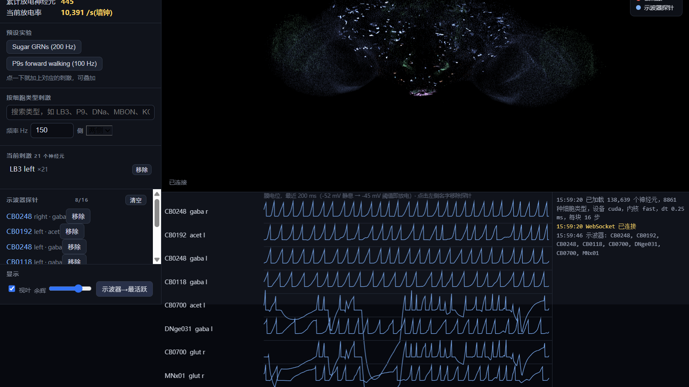
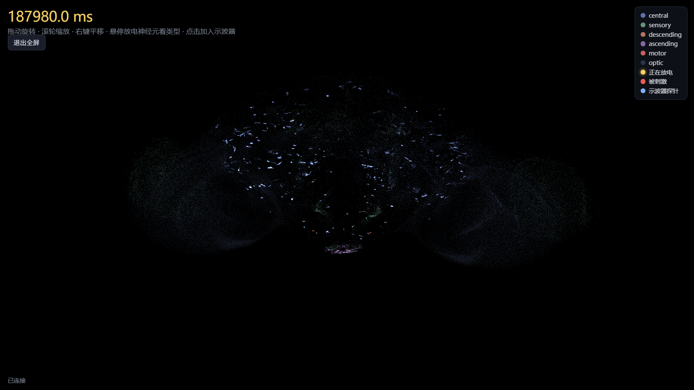
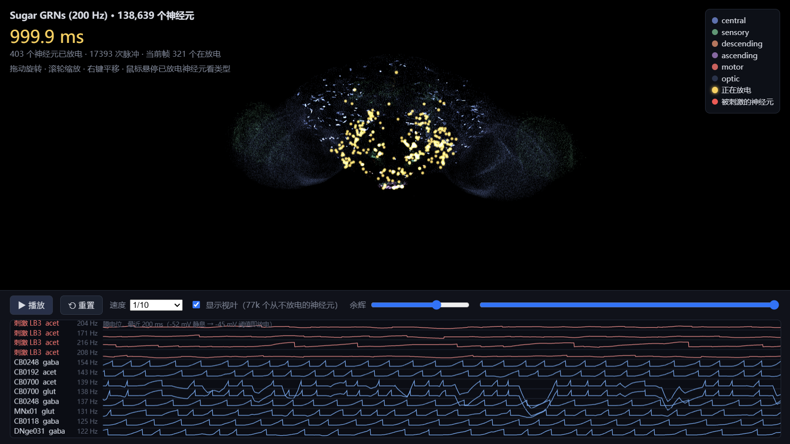

<div align="center">

# 实时控制台教程 · Live Console Guide

[中文](#zh) · [English](#en) · [返回主 README Back to README](../README.md)

</div>

---

<a id="zh"></a>
# 中文版

**目录**：[这是什么](#zh-what) · [启动](#zh-start) · [界面导览](#zh-ui) · [做第一个实验](#zh-first) · [按细胞类型刺激](#zh-type) · [全屏看脑](#zh-full) · [命令行参数](#zh-args) · [用脚本控制大脑](#zh-api) · [导出 3D 回放](#zh-replay) · [排障](#zh-trouble)

<a id="zh-what"></a>
## 这是什么

控制台把果蝇全脑模型跑在本地 GPU 上，通过浏览器实时展示：138,639 个神经元的每一次放电都会变成三维脑图里的一个亮点，延迟在一帧以内。你可以边跑边干预，给任意细胞类型加刺激、给任意神经元挂膜电位探针、暂停、重置，所有操作下一个仿真块就生效。

在 RTX 3060 Laptop（6 GB 显存）上，默认的 fast 内核以 dt 0.25 ms 跑到约 0.4 倍实时，显存占用约 0.45 GB。更快的显卡会更接近甚至超过实时。

[返回目录](#zh)

<a id="zh-start"></a>
## 启动

最简单的办法是双击仓库根目录的 `run_live.bat`，它会启动服务并自动打开浏览器。也可以手动执行：

```bash
.venv/Scripts/python.exe experiments/live_server.py --port 8766
```

然后在浏览器打开 `http://127.0.0.1:8766/`。页面需要从公网加载 three.js，所以浏览器要能访问 cdn.jsdelivr.net。

首次启动要加载连接组数据并编译 CUDA Graph，大约等一两分钟，终端出现服务地址、页面左下角显示"已连接"就可以开始。

[返回目录](#zh)

<a id="zh-ui"></a>
## 界面导览

页面分三块：左侧控制栏、中间三维脑图、底部示波器和日志。



左侧栏从上到下依次是：

| 区域 | 作用 |
|---|---|
| 运行 | 暂停、继续、重置状态、清空刺激；显示脑时间、实时比、每步 GPU 耗时、累计放电神经元数 |
| 预设实验 | 一键施加论文用过的刺激，目前有两个：糖味觉 GRN 200 Hz、P9 前行 100 Hz |
| 按细胞类型刺激 | 搜索 8,861 种细胞类型中的任意一种，按频率和左右侧施加刺激 |
| 当前刺激 | 列出正在受刺激的神经元组，可整组移除 |
| 示波器探针 | 列出已挂探针的神经元，最多 16 个 |
| 显示 | 隐藏视叶（77k 个很少参与中枢计算的神经元）、调放电余辉 |

三维脑图里每个点是一个神经元，颜色按大类区分，金黄色闪光是正在放电，红色是被刺激的，蓝色是挂了探针的。鼠标拖动旋转、滚轮缩放、右键平移。悬停一个放过电的神经元能看到它的细胞类型、神经递质和左右侧，点击就把它加进示波器。

底部示波器画出每个探针最近 200 ms 的膜电位，静息电位 -52 mV，升到阈值 -45 mV 就发放一次脉冲。右下角的日志记录每次操作。

[返回目录](#zh)

<a id="zh-first"></a>
## 做第一个实验

以"果蝇尝到糖"为例，完整流程是：

1. 点预设实验里的 **Sugar GRNs (200 Hz)**。21 个糖味觉感受神经元开始以 200 Hz 被注入泊松脉冲，脑图上红色标记的就是它们，位于脑部腹侧的食道下区。
2. 等几十秒脑时间，看放电从感受神经元传播到中枢。左栏"累计放电神经元"会涨到几百个。
3. 点 **示波器→最活跃**，控制台自动把放电最猛的 8 个下游神经元挂上探针，示波器立刻出现它们的膜电位波形。
4. 想看清某个具体神经元，把鼠标悬停在脑图里发金光的点上，看类型后点击，它就进了示波器。
5. 随时点 **暂停** 冻结仿真慢慢看，点 **重置状态** 把膜电位归零重来（刺激保留），点 **清空刺激** 撤掉所有刺激。

[返回目录](#zh)

<a id="zh-type"></a>
## 按细胞类型刺激

搜索框输入细胞类型名的一部分，比如 `MBON`（蘑菇体输出神经元）、`DNa`（下行神经元）、`KC`（Kenyon 细胞），下方会列出匹配的类型和各自包含的神经元数量。选好频率（1 到 500 Hz）和左右侧，点结果条目即开始刺激。刺激可以叠加，想停掉某一组就在"当前刺激"里点移除。

[返回目录](#zh)

<a id="zh-full"></a>
## 全屏看脑

脑图左上角有一个 **⛶ 全屏看脑** 按钮，点一下收起侧栏和示波器，大脑铺满整个窗口，适合展示和仔细观察放电传播路径，再点一次恢复。



[返回目录](#zh)

<a id="zh-args"></a>
## 命令行参数

| 参数 | 默认 | 说明 |
|---|---|---|
| `--port` | 8766 | 服务端口 |
| `--dt` | 0.25 | 仿真步长 ms，0.1 是论文参考步长，更准也更慢 |
| `--speed` | 1.0 | 速度上限，实时倍数，0 表示不限速 |
| `--dense` | 关 | 换成上游的原始 PyTorch 稠密后端，约 0.02 倍实时，用于对照 |
| `--steps` | 自动 | 每个 CUDA Graph 里打包的步数 |
| `--device` | cuda | 计算设备，没显卡时填 `cpu` |

[返回目录](#zh)

<a id="zh-api"></a>
## 用脚本控制大脑

控制台的所有功能走的是 WebSocket，地址 `ws://127.0.0.1:8766/ws`。写脚本连上它，就能在做实验、训练 agent 或者 vibe coding 的时候实时读大脑状态、施加干预。协议很简单：

客户端发 JSON 命令，常用的是：

| 命令 | 参数 | 作用 |
|---|---|---|
| `stim` | `idx` 神经元序号数组, `rate` Hz | 刺激指定神经元 |
| `stim_type` | `type` 类型名, `side` 可空, `rate` | 按细胞类型刺激 |
| `unstim` / `clear` | `idx` / 无 | 撤掉一组或全部刺激 |
| `silence` / `unsilence` | `idx` | 沉默或恢复指定神经元（阈值拉到无穷大） |
| `probe` | `idx` 最多 16 个 | 设置膜电位探针 |
| `pause` / `resume` / `reset` | 无 | 暂停、继续、重置状态 |
| `speed` | `value` | 改速度上限 |
| `search` | `q` | 搜索细胞类型 |

服务器每个仿真块推一帧二进制：20 字节头（步数、放电数、探针数、块内步数、每步微秒数），后面跟着本块放过电的神经元序号和每个探针每一步的膜电位。仓库里没有现成的客户端库，直接用 Python 的 aiohttp 或 websockets 连，几十行就能跑通。

[返回目录](#zh)

<a id="zh-replay"></a>
## 导出 3D 回放

想把一次实验分享给别人看，用 `run_replay.bat` 或手动执行：

```bash
.venv/Scripts/python.exe experiments/export_3d.py --exp sugar --t 1.0
.venv/Scripts/python.exe experiments/export_3d.py --exp sugar --silence MBON --t 1.0
```

第一条跑糖刺激 1 秒，第二条同样的刺激但把 96 个蘑菇体输出神经元全程沉默，用来对比脉冲传播的差异。产物是 `experiments/out/` 下的单文件 HTML，数据全部内嵌，双击就能在浏览器里播放、拖进度条、调速度，底部带刺激神经元和最活跃下游神经元的膜电位波形，悬停任意放电神经元看类型。文件可以直接发给别人，不需要任何环境。



[展示页](https://arcadiae.github.io/fly-brain/)上嵌了三个这样的回放，不装任何东西也能玩。

[返回目录](#zh)

<a id="zh-trouble"></a>
## 排障

**页面白屏或卡在"连接中"。** 先看终端里服务是否在跑，再确认浏览器能访问 cdn.jsdelivr.net（三维渲染库从那里加载）。

**终端报 CUDA 相关错误。** 确认装的是 CUDA 版 PyTorch，跑 `.venv/Scripts/python.exe -c "import torch; print(torch.cuda.is_available())"` 应输出 True。没有 NVIDIA 显卡就加 `--device cpu`（速度慢很多，只适合验证功能）。

**速度达不到 1 倍实时。** 这是显卡算力决定的，不是故障。RTX 3060 Laptop 约 0.4 倍实时，把速度上限调到"不限"就是全速。dt 0.25 比 dt 0.1 快约 2.5 倍。

**端口被占用。** 换一个端口：`--port 8800`。

[返回目录](#zh)

---

<a id="en"></a>
# English Version

**Contents**: [What this is](#en-what) · [Launch](#en-start) · [Interface tour](#en-ui) · [Your first experiment](#en-first) · [Stimulate by cell type](#en-type) · [Fullscreen brain view](#en-full) · [Command-line options](#en-args) · [Drive the brain from a script](#en-api) · [Export a 3D replay](#en-replay) · [Troubleshooting](#en-trouble)

<a id="en-what"></a>
## What this is

The console runs the whole fly-brain model on your local GPU and shows it live in a browser: every spike of all 138,639 neurons becomes a flash in a 3D brain view within one frame. You can intervene while it runs: stimulate any cell type, attach membrane-voltage probes to any neuron, pause and reset. Every action takes effect on the next simulation block.

On an RTX 3060 Laptop (6 GB VRAM) the default fast kernel runs at about 0.4× real time with dt 0.25 ms, using roughly 0.45 GB of VRAM. Faster GPUs get closer to, or past, real time.

[Back to contents](#en)

<a id="en-start"></a>
## Launch

The easiest way is to double-click `run_live.bat` in the repository root; it starts the server and opens the browser for you. You can also run it by hand:

```bash
.venv/Scripts/python.exe experiments/live_server.py --port 8766
```

Then open `http://127.0.0.1:8766/` in a browser. The page loads three.js from cdn.jsdelivr.net, so the browser needs internet access.

The first launch loads the connectome and builds the CUDA graph, which takes a minute or two. Once the terminal prints the address and the page shows "已连接" (connected) in the lower left, you are ready.

[Back to contents](#en)

<a id="en-ui"></a>
## Interface tour

The page has three parts: a control sidebar on the left, the 3D brain in the middle, and an oscilloscope plus log at the bottom.


The sidebar, from top to bottom:

| Section | What it does |
|---|---|
| Run | Pause, resume, reset state, clear stimuli; shows brain time, real-time ratio, GPU time per step, total neurons fired |
| Preset experiments | One-click stimuli from the paper: sugar GRNs at 200 Hz, P9 forward walking at 100 Hz |
| Stimulate by cell type | Search all 8,861 cell types and stimulate by rate and side |
| Current stimuli | Lists the stimulated groups, removable one by one |
| Oscilloscope probes | Lists probed neurons, up to 16 |
| Display | Hide the optic lobes (77k neurons that rarely join central computation), adjust the spike afterglow |

In the 3D view each dot is a neuron, colored by super class. Gold flashes are spikes, red marks stimulated neurons, blue marks probes. Drag to rotate, scroll to zoom, right-drag to pan. Hovering a neuron that has fired shows its cell type, neurotransmitter and side; clicking adds it to the oscilloscope.

The oscilloscope draws the last 200 ms of membrane voltage for each probe: resting potential is -52 mV, and a spike fires when the voltage reaches the -45 mV threshold. The log in the lower right records every action.

[Back to contents](#en)

<a id="en-first"></a>
## Your first experiment

Using "the fly tastes sugar" as the example:

1. Click **Sugar GRNs (200 Hz)** in the preset section. 21 sugar gustatory receptor neurons start receiving 200 Hz Poisson input; they are marked red, in the subesophageal zone on the ventral side of the brain.
2. Let it run for tens of seconds of brain time and watch the activity spread into the central brain. The "total neurons fired" counter climbs to a few hundred.
3. Click **示波器→最活跃** (scope: most active). The console automatically probes the 8 most active downstream neurons and their voltage traces appear immediately.
4. To inspect a specific neuron, hover over a gold flashing dot to see its type, then click to add it to the scope.
5. Use **暂停** (pause) to freeze the simulation, **重置状态** (reset state) to zero all voltages while keeping stimuli, and **清空刺激** (clear) to remove all stimuli.

[Back to contents](#en)

<a id="en-type"></a>
## Stimulate by cell type

Type part of a cell-type name into the search box, such as `MBON` (mushroom body output neurons), `DNa` (descending neurons) or `KC` (Kenyon cells). Matching types appear with their neuron counts. Pick a rate (1 to 500 Hz) and a side, then click a result to start stimulating. Stimuli stack; remove any group from the "current stimuli" list.

[Back to contents](#en)

<a id="en-full"></a>
## Fullscreen brain view

The **⛶ 全屏看脑** (fullscreen) button in the upper left of the brain view collapses the sidebar and oscilloscope so the brain fills the whole window. Click again to restore.


[Back to contents](#en)

<a id="en-args"></a>
## Command-line options

| Option | Default | Meaning |
|---|---|---|
| `--port` | 8766 | Server port |
| `--dt` | 0.25 | Time step in ms; 0.1 is the paper's reference step, more accurate and slower |
| `--speed` | 1.0 | Speed cap as a multiple of real time; 0 means unthrottled |
| `--dense` | off | Use the original dense PyTorch backend (about 0.02× real time) for comparison |
| `--steps` | auto | Steps packed into each CUDA graph |
| `--device` | cuda | Compute device; use `cpu` without a GPU (much slower) |

[Back to contents](#en)

<a id="en-api"></a>
## Drive the brain from a script

Everything the console does goes through a WebSocket at `ws://127.0.0.1:8766/ws`. Connect from a script and you can read brain state and apply interventions in real time, which is handy for experiments, agent training, or vibe coding. The protocol is small.

The client sends JSON commands:

| Command | Arguments | Effect |
|---|---|---|
| `stim` | `idx` array, `rate` Hz | Stimulate given neurons |
| `stim_type` | `type`, optional `side`, `rate` | Stimulate a cell type |
| `unstim` / `clear` | `idx` / none | Remove one group or all stimuli |
| `silence` / `unsilence` | `idx` | Silence or restore neurons (threshold pushed to infinity) |
| `probe` | `idx`, up to 16 | Set voltage probes |
| `pause` / `resume` / `reset` | none | Pause, resume, reset state |
| `speed` | `value` | Change the speed cap |
| `search` | `q` | Search cell types |

The server pushes one binary frame per simulation block: a 20-byte header (step, spike count, probe count, steps per block, microseconds per step), followed by the indices of neurons that spiked and the per-step voltages of every probe. There is no client library in the repo; connecting with Python's aiohttp or websockets takes a few dozen lines.

[Back to contents](#en)

<a id="en-replay"></a>
## Export a 3D replay

To share an experiment with someone, use `run_replay.bat` or run:

```bash
.venv/Scripts/python.exe experiments/export_3d.py --exp sugar --t 1.0
.venv/Scripts/python.exe experiments/export_3d.py --exp sugar --silence MBON --t 1.0
```

The first command simulates one second of sugar stimulation; the second runs the same stimulus with all 96 mushroom body output neurons silenced, so you can compare how spikes propagate. The output is a single self-contained HTML file under `experiments/out/`. Double-click it to play, scrub the timeline and change speed, with voltage traces of stimulated and most-active downstream neurons at the bottom, and hover tooltips on every firing neuron. You can send the file to anyone; no environment needed.


Three such replays are embedded in the [project site](https://arcadiae.github.io/fly-brain/), so you can try them without installing anything.

[Back to contents](#en)

<a id="en-trouble"></a>
## Troubleshooting

**Blank page or stuck on "connecting".** Check that the server is running in the terminal, and that the browser can reach cdn.jsdelivr.net (the 3D library loads from there).

**CUDA errors in the terminal.** Make sure a CUDA build of PyTorch is installed: `.venv/Scripts/python.exe -c "import torch; print(torch.cuda.is_available())"` should print True. Without an NVIDIA GPU, add `--device cpu` (much slower, fine for checking that things work).

**Slower than 1× real time.** That is determined by your GPU, not a bug. An RTX 3060 Laptop manages about 0.4×; set the speed cap to "unlimited" to run flat out. dt 0.25 is about 2.5 times faster than dt 0.1.

**Port already in use.** Pick another one with `--port 8800`.

[Back to contents](#en)
